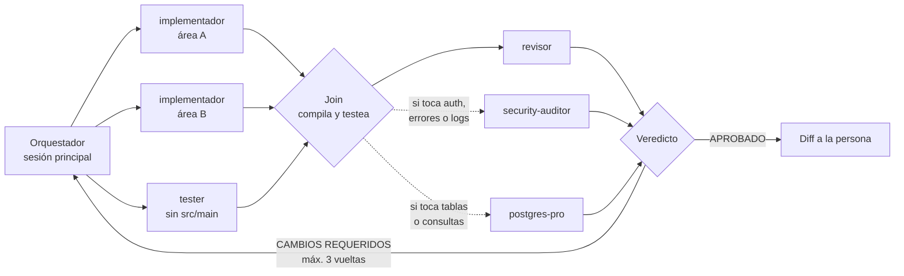

# Conceptos

Lo mínimo que necesitás saber antes de usar los agentes.

## OpenSpec

[OpenSpec](https://github.com/Fission-AI/OpenSpec) organiza el trabajo en **changes**. Cada change vive en `openspec/changes/<change-id>/` y tiene:

- **`proposal.md`:** por qué se hace el cambio.
- **`specs/`:** los requirements, cada uno con sus **Scenarios** (WHEN / THEN). Son el contrato: lo que el sistema tiene que hacer.
- **`design.md`:** cómo se va a hacer: rutas, forma de los JSON, decisiones técnicas.
- **`tasks.md`:** las tareas, agrupadas, con checkboxes.

Los comandos `/opsx:*` de Claude Code recorren el ciclo: `propose` → `apply` → `verify` → `archive`. Los agentes trabajan en el **apply** y en el **verify**.

## Subagente

Un agente de Claude Code con su propio archivo de instrucciones (`.claude/agents/<nombre>.md`), su modelo y sus herramientas. Arranca **sin el contexto de la conversación principal**: solo sabe lo que le pasa el orquestador y lo que lee por su cuenta. Eso es una ventaja (contexto limpio, independencia) y un costo (relee los artefactos).

## Orquestador

La sesión principal de Claude Code, la que habla con vos. Reparte las tareas, crea los worktrees, lanza los subagentes, junta su trabajo y te muestra el diff. **No es un agente de este repo:** es tu sesión siguiendo el procedimiento de [Uso](05-uso.md).

## Grupo

Un bloque de tareas de `tasks.md` que se hace de una vez. El grafo corre una vez por grupo.

## Worktree

Una copia de trabajo extra del mismo repo git, en otra carpeta y sobre el mismo branch base (`git worktree add`). Cada implementador y el tester trabajan en el suyo, en `.worktrees/<área>`, para no pisarse.

## Join

El momento en que el orquestador junta el trabajo de todos los worktrees en el branch del change, compila y corre los tests. Es la primera vez que los tests del tester tocan el código real.

## Hook

Un comando que Claude Code corre antes o después de usar una herramienta. El tester tiene un hook `PreToolUse` (`hooks/tester-sin-src-main.js`) que rechaza sus lecturas de `src/main`.

## El grafo completo

